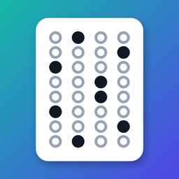

<h1 align="center">Gradal — اختبارات تُكتب بالذكاء الاصطناعي وتُصحَّح بكاميرا الجوال</h1>

**Gradal تطبيق آيفون مجاني ومفتوح المصدر للمعلم، يعمل وحده بلا كمبيوتر.**

تضيف إليه كتاب المنهج ملف PDF، لأي مادة، بالعربية أو بالإنجليزية، فيكتب أسئلة الاختبار. ثم يجهّز ورقة الأسئلة ونموذج الإجابة وورقة إجابة باسم كل طالب. فتطبعها من الجوال، وتصحح الأوراق بكاميرته في ثوانٍ، وتشارك سجل الدرجات ملف Excel.

**[دليل الاستخدام خطوة بخطوة](دليل-الاستخدام.md)**

## مزاياه

- **يكتب الأسئلة من كتابك:** تختار الصفحات، وتسمّي أقسام الورقة كما تريد، وتحدد نوع كل قسم وعدد أسئلته. ثم تراجع الأسئلة وتعدّلها قبل اعتمادها.
- **مجاني:** يعمل بمزوّدي ذكاء اصطناعي مجانيين، مثل Gemini وQwen وGroq، بمفتاح يلصقه المعلم مرة واحدة.
- **عربي أولًا:**
  - للمواد العربية رأس ورقة عربي: أسطر الوزارة يمينًا، والشعار في الوسط، والمدرسة والمادة والصف والمعلم يسارًا.
  - الاختبار العربي من اليمين إلى اليسار، وبدائله أ ب ج د.
  - ولمادة اللغة الإنجليزية ورقتها الإنجليزية.
- **أسماء الطلاب تلقائيًا:** من ملف Excel أو PDF تصدّره من نور، فيعرف الفصول ويعطي كل طالب رقمه. أو بلصق الأسماء، أو بإضافة طالب يدويًا.
- **يطبع من الجوال:** على أي طابعة AirPrint في المدرسة.
- **يصحح بالكاميرا:** يعرف الاختبار والطالب من الورقة نفسها، فلا تختار شيئًا قبل المسح، والمسح يعمل بلا إنترنت.
- **النتائج:** درجة كل طالب، والإحصاءات، وتحليل كل سؤال، وسجل Excel فيه ورقة لكل فصل.
- **بياناتك عندك:** كل شيء في جوالك، بلا حساب ولا خادم ولا اشتراك، مع نسخة احتياطية إلى «الملفات» أو iCloud.

| ورقة الأسئلة | ورقة الإجابة |
|---|---|
|  |  |

## أقسام التطبيق

| القسم | ما فيه |
|---|---|
| **الاختبارات** | اختبار جديد من كتاب، أو بمفتاح جاهز، ومراجعة الأسئلة، وطباعة الأوراق، والمسح، والنتائج، وتحليل الأسئلة، وسجل Excel |
| **الطلاب** | الاستيراد من Excel أو PDF، ولصق الأسماء، وإضافة طالب، والأرشفة في سنة دراسية جديدة |
| **الإعدادات** | ربط الذكاء الاصطناعي، ورأس الورقة (أسطر الوزارة، واسم المدرسة والمعلم، والشعار)، والنسخ الاحتياطي واستعادته |

## التثبيت

التطبيق غير منشور في App Store بعد، فيُثبَّت من ملف IPA:

1. نزّل `Gradal-unsigned.ipa` من صفحة **[الإصدارات](https://github.com/ibnkabed/gradal/releases)**.
2. ثبّته على الآيفون بأداة [Sideloadly](https://sideloadly.io/) وحساب Apple عادي.
3. في الآيفون: الإعدادات ← عام ← VPN وإدارة الأجهزة، ثم وثّق حسابك.

والتفصيل في [دليل الاستخدام](دليل-الاستخدام.md#التثبيت).

الحساب المجاني يتطلب إعادة التوقيع كل سبعة أيام. ولنشره رسميًا في المدارس يلزم حساب Apple للمطورين، ثم App Store أو TestFlight.

## الذكاء الاصطناعي (مجانًا)

يكتب الأسئلة مزوّد تربطه أنت بمفتاحك، من «الإعدادات»:

1. اضغط «افتح صفحة المفتاح» عند المزوّد.
2. أنشئ مفتاحًا، ثم الصقه واضغط «اربط».

يتحقق Gradal من المفتاح فورًا، ويختار أنسب نموذج لكتابة الأسئلة.

| المزوّد | الكلفة | ملاحظة |
|---|---|---|
| Google Gemini | مجاني بحصة يومية | الأنسب للبداية، ويقرأ الكتب المصوّرة وملفات PDF من نور |
| Alibaba Qwen | حصة مجانية عند التسجيل | قوي في العربية |
| Groq | مجاني | سريع جدًا |
| Cerebras | مجاني بحدود في الدقيقة | |
| Mistral | خطة مجانية | |
| OpenRouter | نماذج مجانية بحد يومي صغير | احتياط |
| DeepSeek | مدفوع ورخيص جدًا | يُستعمل بعد المجانيين |

يكفي مزوّد واحد. وإن ربطت اثنين، راجع الثاني أسئلة الأول على نص الكتاب.

## الخصوصية

- كل البيانات في جوال المعلم وحده، ولا تُرفع إلى أي خادم: الطلاب، والكتب، والاختبارات، والأوراق الممسوحة.
- المفاتيح محفوظة في خزنة الجوال، ولا تُرسل إلا إلى مزوّدها.
- لا يصل إلى المزوّد إلا ما يلزم لعمله:
  - نصوص صفحات الكتاب التي اخترتها.
  - ملف قائمة الطلاب، إن طلبت من الذكاء الاصطناعي قراءته.

## حدود معلومة

- **عدد الأسئلة:** من 5 إلى 60 في الاختبار الواحد، والبدائل أربعة على الأكثر.
- **الكتاب:** ثلاثون صفحة على الأكثر للاختبار الواحد.
- **الفصول والطلاب:** أرقام الطلاب من ثلاث خانات، الأولى رقم الفصل. فالفصول تسعة على الأكثر في السنة الواحدة، و99 طالبًا على الأكثر في الفصل.
- **الطباعة:** على ورق A4 بمقياس 100٪. والتصغير «ليناسب الصفحة» يفسد قراءة الورقة. ومنذ النسخة 2.3 يختار التطبيق ورق A4 بنفسه عند الطباعة، لأن ورق Letter يقص مربعي الزاويتين السفليين فلا تُقرأ الورقة.
- **صحة الأسئلة:** الأسئلة المكتوبة بالذكاء الاصطناعي مسودة، والمعلم مسؤول عن مراجعتها قبل اعتمادها.

## للمطورين

- `ios/`: التطبيق بـ SwiftUI ومشروع XcodeGen. يُبنى بلا Mac في GitHub Actions، وكل وسم `v*` ينشر ملف IPA في الإصدارات.
- `shared/sheet-layouts.json`: شكل ورقة الإجابة.
- `docs/DATA.md` و`docs/DESIGN.md`: وصف البيانات وأجزاء التطبيق، وهما بالإنجليزية.
- `reference/`: النسخ المرجعية بلغة Python، ومنها نُقل كل جزء. وفي كل بناء:
  - يُفحص قارئ الكاميرا على صور أوراق مصطنعة، عربية وإنجليزية.
  - ويُقارن حساب مواضع الأسئلة بالمرجع.
  - وتُرسم أوراق الإجابة ثم تُقرأ للتأكد منها.

المساهمات مرحّب بها: افتح Issue أو Pull Request.

## الترخيص

مفتوح المصدر بترخيص [MIT](LICENSE): يجوز استعماله ونسخه وتعديله ونشره مجانًا.

