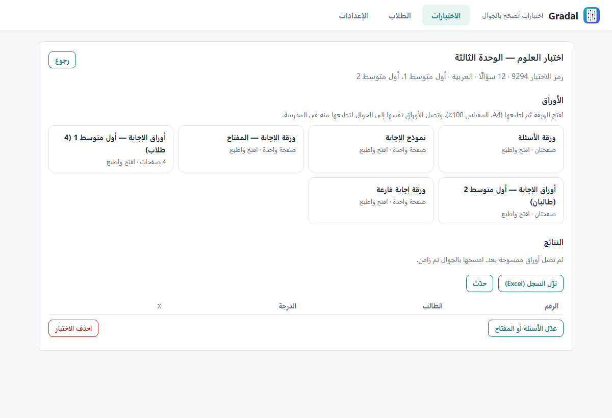

<div dir="rtl">

# Gradal — اختبارات تُكتب بالذكاء الاصطناعي وتُصحَّح بكاميرا الجوال

[](https://github.com/ibnkabed/gradal/actions/workflows/tests.yml)
[](LICENSE)

**Gradal تطبيق مجاني مفتوح المصدر للمعلم.** يكتب أسئلة الاختبار من أي كتاب PDF، لأي مادة، بالعربية أو بالإنجليزية. ويطبع ورقة الأسئلة وورقة إجابة باسم كل طالب. ثم يصحح الأوراق بكاميرا الآيفون في ثوانٍ، ويخرج سجل الدرجات في ملف Excel.

- **يكتب الأسئلة من كتابك:** ترفع ملف PDF للمنهج، وتختار الصفحات وعدد الأسئلة، فيكتبها لك. وتراجعها وتعدّلها قبل اعتمادها.
- **مجاني:** يعمل بمزوّدي ذكاء اصطناعي مجانيين، مثل Gemini وQwen وGroq، بمفتاح يلصقه المعلم مرة واحدة.
- **عربي وإنجليزي:** الاختبار العربي من اليمين إلى اليسار، وبدائله أ ب ج د.
- **يُطبع من الجوال:** تُجهَّز الأوراق في الكمبيوتر، وتُطبع من الآيفون في المدرسة على أي طابعة AirPrint.
- **يصحح بالكاميرا:** يعرف الجوال الاختبار والطالب من الورقة نفسها، فلا يختار المعلم شيئًا قبل المسح.
- **بياناتك عندك:** كل شيء على كمبيوترك وجوالك، بلا حساب ولا خادم ولا اشتراك.

<!-- صور الشاشة: docs/screenshots -->
| ورقة الإجابة (عربي) | ورقة الأسئلة | نافذة الكمبيوتر |
|---|---|---|
|  |  |  |

---

## كيف يعمل

1. **الكمبيوتر (Windows):** تضيف فصولك من ملف Excel تصدّره من نور، أو تلصق الأسماء. ثم تنشئ الاختبار بإحدى طريقتين:
   - **من كتاب:** ترفع ملف PDF، وتحدد الصفحات وعدد أسئلة «الاختيار من متعدد» و«الصح أو الخطأ»، فيكتبها الذكاء الاصطناعي. وإن ربطت مزوّدين يراجع الثاني ما كتبه الأول.
   - **بمفتاح جاهز:** لاختبار أعددته بنفسك، فتدخل مفتاح الإجابة فقط.
2. **الأوراق:** يجهّز Gradal أوراق كل اختبار:
   - ورقة الأسئلة.
   - نموذج الإجابة.
   - ورقة المفتاح.
   - ورقة إجابة لكل طالب، باسمه ورقمه مظللًا مسبقًا.
   - ورقة إجابة فارغة.
3. **الجوال (آيفون):** يتزامن مع الكمبيوتر على الشبكة نفسها، فينزّل الأوراق لتطبعها منه في أي مكان. ثم «امسح الأوراق»: توجّه الكاميرا إلى الورقة فتُصحَّح فورًا.
4. **النتائج:** تعود إلى الكمبيوتر في المزامنة التالية، ومعها:
   - سجل Excel لكل اختبار، فيه ورقة لكل فصل.
   - إحصاءات الاختبار.
   - تحليل لكل سؤال.

## التثبيت

### الكمبيوتر (Windows 10 أو 11)

1. نزّل المستودع من زر **Code ← Download ZIP**، ثم فك الضغط في مجلد دائم، مثل «المستندات».
2. انقر نقرًا مزدوجًا على **`Gradal.cmd`**. في المرة الأولى:
   - يثبّت Python إن لم يكن مثبتًا.
   - يجهّز ما يحتاجه البرنامج، في بضع دقائق مرة واحدة.
   - يضع اختصارًا على سطح المكتب.
3. إذا سأل Windows عن السماح لـ Python بالشبكة، فاختر **السماح على الشبكات الخاصة**، ليصل إليه الجوال.

بياناتك كلها في مجلد واحد: `المستندات\Gradal`. انسخه احتياطًا من حين لآخر.

### الآيفون

التطبيق غير منشور في App Store بعد. ثبّته من ملف IPA:

1. نزّل `Gradal-unsigned.ipa` من صفحة **[Releases](https://github.com/ibnkabed/gradal/releases)**.
2. ثبّته بـ [Sideloadly](https://sideloadly.io/) وحساب Apple مجاني. وفي الآيفون: الإعدادات ← عام ← إدارة الأجهزة، ثم وثّق حسابك.
3. الحساب المجاني يتطلب إعادة التوقيع كل سبعة أيام. ولنشره رسميًا في المدارس يلزم حساب Apple للمطورين، ثم App Store أو TestFlight.

### ربط الذكاء الاصطناعي (مجانًا)

من **الإعدادات** في نافذة الكمبيوتر:

1. اختر مزوّدًا، واضغط «افتح صفحة المفتاح».
2. أنشئ مفتاحًا، ثم الصقه واضغط «اربط».

يتحقق Gradal من المفتاح فورًا، ويختار من نماذج المزوّد أنسبها لكتابة الأسئلة.

| المزوّد | الكلفة | ملاحظة |
|---|---|---|
| Google Gemini | مجاني بحصة يومية | الأنسب للبداية، ويقرأ الكتب المصوّرة (صفحات بلا نص) |
| Alibaba Qwen | حصة مجانية عند التسجيل | قوي في العربية |
| Groq | مجاني | سريع جدًا |
| Cerebras | مجاني بحدود في الدقيقة | |
| Mistral | خطة مجانية | |
| OpenRouter | نماذج مجانية بحد يومي صغير | احتياط |
| DeepSeek | مدفوع ورخيص جدًا | يُستعمل بعد المجانيين |

تبقى المفاتيح في جهازك، ولا تُرسل إلا إلى مزوّدها. وتُرسل إلى المزوّد نصوص الصفحات التي اخترتها فقط.

## الأقسام

| في الكمبيوتر | في الجوال |
|---|---|
| **الاختبارات:** اختبار جديد من كتاب أو بمفتاح جاهز، ومراجعة الأسئلة، والأوراق، والنتائج | **الاختبارات:** الطباعة، والمسح، والنتائج، وتحليل الأسئلة، ومشاركة السجل |
| **الطلاب:** الاستيراد من نور أو لصق الأسماء، والأرشفة في سنة جديدة | **الإعدادات:** الاقتران بالكمبيوتر والمزامنة |
| **الإعدادات:** الذكاء الاصطناعي، والجوال، ورأس الورقة، ومكان البيانات | |

## حدود معلومة

- **عدد الأسئلة:** من 5 إلى 60 في الاختبار الواحد، وبدائل كل سؤال أربعة على الأكثر.
- **أرقام الطلاب:** من ثلاث خانات، الأولى رقم الفصل. فالفصول تسعة على الأكثر في السنة الواحدة، و99 طالبًا على الأكثر في الفصل.
- **الطباعة:** على ورق A4 بمقياس 100٪. والتصغير «ليناسب الصفحة» يفسد قراءة الورقة.
- **الشبكة:** يتزامن الجوال مع الكمبيوتر على الشبكة المحلية نفسها فقط. والمسح نفسه يعمل بلا إنترنت.
- **صحة الأسئلة:** الأسئلة المكتوبة بالذكاء الاصطناعي مسودة، والمعلم مسؤول عن مراجعتها قبل اعتمادها.

## للمطورين

- `pc/`: تطبيق الكمبيوتر، بلغة Python 3.12 ومكتبتها القياسية، ومعها `pymupdf` و`openpyxl` و`xlrd`.
  - `server.py`: الخادم.
  - `exam_maker.py`: كاتب الأسئلة.
  - `ai.py`: المزوّدون.
  - `sheets.py` و`sheet_layout.py`: ورقة الإجابة.
  - `paper.py`: ورقة الأسئلة.
  - `omr.py`: القارئ المرجعي.
- `ios/`: تطبيق الآيفون بـ SwiftUI ومشروع XcodeGen. يُبنى بلا Mac في GitHub Actions (`.github/workflows/build-ipa.yml`).
- `shared/`: شكل الورقة (`sheet-layouts.json`) والعقد بين الطرفين (`PROTOCOL.md`).
- **الاختبارات:**

  ```powershell
  python -m unittest discover -s pc/tests -v
  ```

  وقارئ Swift منقول سطرًا بسطر عن `pc/omr.py`، ويفحصه `OMRCheck` في كل بناء.

المساهمات مرحّب بها: افتح Issue أو Pull Request.

</div>

---

## English summary

**Gradal** is a free, open-source app for teachers. It writes test questions from any PDF textbook, in
Arabic or English, with free AI providers (Gemini, Qwen, Groq, Cerebras, Mistral, OpenRouter, or the
low-cost DeepSeek). It prints the question paper and a personalised bubble answer sheet for each
student. Then it grades the sheets with the iPhone camera (optical mark recognition, offline) and writes
an Excel grade book.

The quiz is made on a Windows PC. The iPhone downloads the papers at sync and prints them with AirPrint
at school. It scans and grades on the spot, then syncs the results back over the local network.
Local-first: no account, no server, no subscription. Arabic quizzes are fully right-to-left (choices
أ ب ج د).

- **PC:** download the ZIP, then double-click `Gradal.cmd`. The first run installs Python if needed.
- **iPhone:** install the IPA from Releases with Sideloadly.
- **AI:** paste a free key in Settings. Gradal checks the key and picks a suitable model by itself.

License: [MIT](LICENSE).
