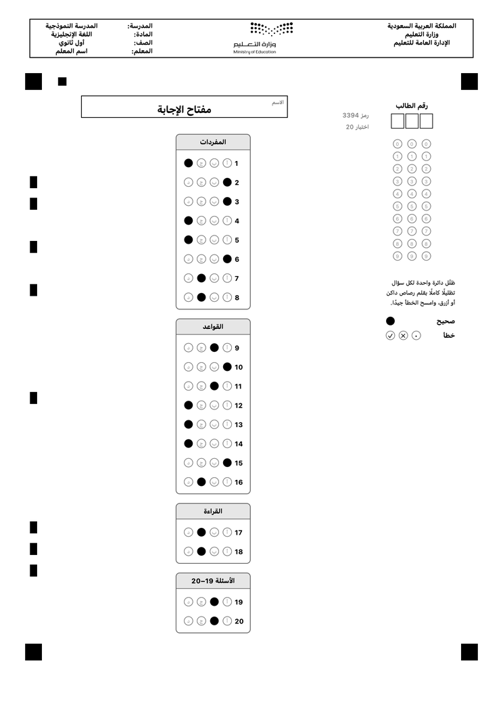
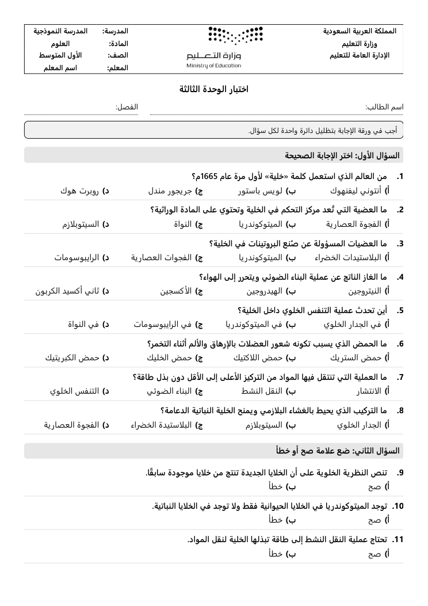

# Gradal — اختبارات تُكتب بالذكاء الاصطناعي وتُصحَّح بكاميرا الجوال

**Gradal تطبيق آيفون مجاني ومفتوح المصدر للمعلم، يعمل وحده بلا كمبيوتر.** تضيف إليه كتاب المنهج ملف PDF، لأي مادة، بالعربية أو بالإنجليزية، فيكتب أسئلة الاختبار. ثم يجهّز ورقة الأسئلة ونموذج الإجابة وورقة إجابة باسم كل طالب. فتطبعها من الجوال، وتصحح الأوراق بكاميرته في ثوانٍ، وتشارك سجل الدرجات ملف Excel.

- **يكتب الأسئلة من كتابك:** تختار الصفحات وعدد أسئلة «الاختيار من متعدد» و«الصح أو الخطأ»، فيكتبها لك. وتراجعها وتعدّلها قبل اعتمادها.
- **مجاني:** يعمل بمزوّدي ذكاء اصطناعي مجانيين، مثل Gemini وQwen وGroq، بمفتاح يلصقه المعلم مرة واحدة.
- **عربي وإنجليزي:** الاختبار العربي من اليمين إلى اليسار، وبدائله أ ب ج د، في ورقة الأسئلة وورقة الإجابة.
- **يطبع من الجوال:** على أي طابعة AirPrint في المدرسة.
- **يصحح بالكاميرا:** يعرف الاختبار والطالب من الورقة نفسها، فلا تختار شيئًا قبل المسح، والمسح يعمل بلا إنترنت.
- **بياناتك عندك:** كل شيء في جوالك، بلا حساب ولا خادم ولا اشتراك، مع نسخة احتياطية إلى «الملفات» أو iCloud.

| ورقة الإجابة (عربي) | ورقة الأسئلة |
|---|---|
|  |  |

---

## كيف يعمل

التطبيق ثلاثة أقسام:

1. **الطلاب:** تُضاف الأسماء بثلاث طرق:
   - **تلقائيًا من ملف:** صدّر قائمة الطلاب من نور ملف Excel أو PDF، ثم اختره من «الملفات». يعرف Gradal الفصول ويعطي كل طالب رقمه وحده. وملف PDF يقرؤه الذكاء الاصطناعي إن رُبط، وإلا قرأ Gradal نصه بنفسه.
   - **بلصق الأسماء:** اسم في كل سطر.
   - **يدويًا:** طالب واحد في فصل قائم أو جديد.

   ولكل طالب رقم من ثلاث خانات يُطبع مظللًا في ورقته.
2. **الاختبارات:** تنشئ الاختبار بإحدى طريقتين:
   - **من كتاب:** تضيف ملف PDF، وتحدد الصفحات، ثم أقسام الورقة كما تريدها: اسم كل قسم («السؤال الأول: اختر الإجابة الصحيحة»…)، ونوعه (اختيار من متعدد أو صح وخطأ)، وعدد أسئلته. فيكتبها الذكاء الاصطناعي. وإن ربطت مزوّدين يراجع الثاني ما كتبه الأول. ثم تراجع الأسئلة وتعتمدها.
   - **بمفتاح جاهز:** لاختبار أعددته بنفسك، فتدخل مفتاح الإجابة فقط.

   ثم تطبع من صفحة الاختبار:
   - ورقة الأسئلة.
   - نموذج الإجابة.
   - ورقة المفتاح.
   - أوراق الإجابة بأسماء الطلاب.
   - ورقة إجابة فارغة.

   وبعد الاختبار «امسح الأوراق»: توجّه الكاميرا إلى الورقة فتُصحَّح فورًا. ثم ترى النتائج وتحليل كل سؤال، وتشارك السجل ملف Excel.
3. **الإعدادات:**
   - ربط الذكاء الاصطناعي.
   - رأس الورقة: أسطر الوزارة، واسم المدرسة، واسم المعلم، والشعار (شعار وزارة التعليم افتراضيًا). وللمواد العربية رأس عربي: أسطر الوزارة يمينًا، والشعار في الوسط، والمدرسة والمادة والصف والمعلم يسارًا.
   - النسخ الاحتياطي واستعادته.

## التثبيت

التطبيق غير منشور في App Store بعد، فيُثبَّت من ملف IPA:

1. نزّل `Gradal-unsigned.ipa` من صفحة **[Releases](https://github.com/ibnkabed/gradal/releases)**.
2. ثبّته بـ [Sideloadly](https://sideloadly.io/) وحساب Apple مجاني. وفي الآيفون: الإعدادات ← عام ← VPN وإدارة الأجهزة، ثم وثّق حسابك.
3. الحساب المجاني يتطلب إعادة التوقيع كل سبعة أيام. ولنشره رسميًا في المدارس يلزم حساب Apple للمطورين، ثم App Store أو TestFlight.

## ربط الذكاء الاصطناعي (مجانًا)

من «الإعدادات»:

1. اختر مزوّدًا، واضغط «افتح صفحة المفتاح».
2. أنشئ مفتاحًا، ثم الصقه واضغط «اربط».

يتحقق Gradal من المفتاح فورًا، ويختار من نماذج المزوّد أنسبها لكتابة الأسئلة.

| المزوّد | الكلفة | ملاحظة |
|---|---|---|
| Google Gemini | مجاني بحصة يومية | الأنسب للبداية، ويقرأ الكتب المصوّرة (صفحات بلا نص) |
| Alibaba Qwen | حصة مجانية عند التسجيل | قوي في العربية |
| Groq | مجاني | سريع جدًا |
| Cerebras | مجاني بحدود في الدقيقة | |
| Mistral | خطة مجانية | |
| OpenRouter | نماذج مجانية بحد يومي صغير | احتياط |
| DeepSeek | مدفوع ورخيص جدًا | يُستعمل بعد المجانيين |

تبقى المفاتيح في جوالك، ولا تُرسل إلا إلى مزوّدها. وتُرسل إلى المزوّد نصوص الصفحات التي اخترتها فقط.

## حدود معلومة

- **عدد الأسئلة:** من 5 إلى 60 في الاختبار الواحد، والبدائل أربعة على الأكثر.
- **الكتاب:** ثلاثون صفحة على الأكثر للاختبار الواحد.
- **أرقام الطلاب:** من ثلاث خانات، الأولى رقم الفصل. فالفصول تسعة على الأكثر في السنة الواحدة، و99 طالبًا على الأكثر في الفصل.
- **الطباعة:** على ورق A4 بمقياس 100٪. والتصغير «ليناسب الصفحة» يفسد قراءة الورقة.
- **صحة الأسئلة:** الأسئلة المكتوبة بالذكاء الاصطناعي مسودة، والمعلم مسؤول عن مراجعتها قبل اعتمادها.

## للمطورين

- `ios/`: التطبيق بـ SwiftUI ومشروع XcodeGen. يُبنى بلا Mac في GitHub Actions (`.github/workflows/build-ipa.yml`)، وكل وسم `v*` ينشر ملف IPA في Releases.
- `shared/sheet-layouts.json`: شكل الورقة. و`docs/DATA.md`: البيانات وورقة الإجابة. و`docs/DESIGN.md`: أجزاء التطبيق.
- `reference/`: النسخ المرجعية بلغة Python، ومنها نُقل كل جزء بلغة Swift. وفي كل بناء:
  - يُفحص قارئ Swift على صور أوراق مصطنعة، عربية وإنجليزية.
  - ويُقارن حساب مواضع الأسئلة بالمرجع.
  - وتُفحص قواعد كتابة الأسئلة واستيراد الطلاب.

المساهمات مرحّب بها: افتح Issue أو Pull Request.

---

## English summary

**Gradal** is a free, open-source iPhone app for teachers that works on its own, with no computer. Add a textbook
PDF (any subject, Arabic or English). Free AI providers (Gemini, Qwen, Groq, Cerebras, Mistral, OpenRouter, or the
low-cost DeepSeek) write the questions, which you review. The app then makes the question paper, the answer key and
a personalised bubble answer sheet for each student, and prints them with AirPrint. It grades the filled sheets with
the camera (offline optical mark recognition) and shares an Excel grade book.

Local-first: no account, no server, no subscription. Arabic quizzes are fully right-to-left (choices أ ب ج د).
Install the IPA from Releases with Sideloadly. License: [MIT](LICENSE).
